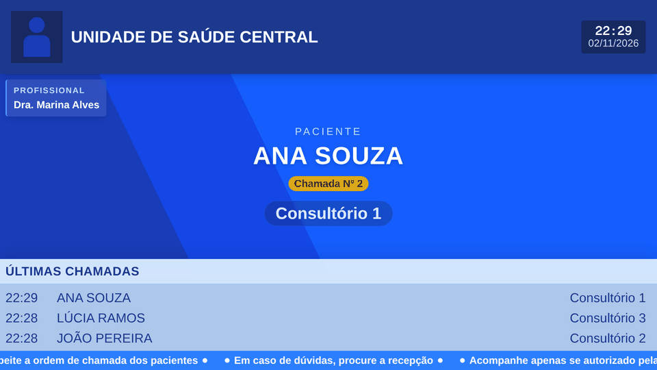
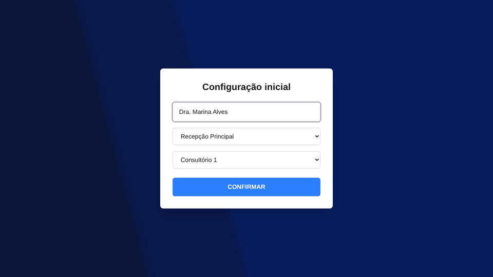
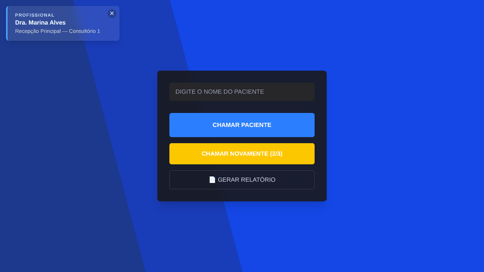
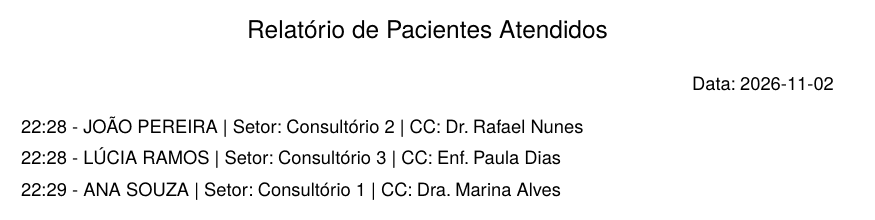

# Painel de Chamadas

Patient call system for health units, built by Caique and me. The professional types the patient's name on a menu in the office, and a TV in the waiting room shows the name and the room while a synthesized voice reads the call aloud.

We made it to sell to health units. It never got a customer and was never used with real patients. The interface is in Brazilian Portuguese.


## Demo video

[](https://youtu.be/C7DnWuI7jQk)

## Screenshots

The TV panel during a second call, with the last three calls at the bottom:



The menu used by the professional:

| First setup | Calling a patient |
|---|---|
|  |  |

The daily report:



Captured on a local database with fictional names.

## How it works

1. On the menu (`/`), the professional enters their name and picks the area and the room once. The choice is saved in the browser, so the next visit goes straight to the call screen.
2. CHAMAR PACIENTE sends `POST /call` and the call enters the queue as `waiting`.
3. Every 500 ms the backend looks at each area that has a panel open. If nothing is playing there, it takes the oldest waiting call, generates an MP3 with [edge-tts](https://github.com/rany2/edge-tts) (voice `pt-BR-AntonioNeural`) and sends it to the panels through Server-Sent Events ([`audio.service.ts`](backend/src/audio/audio.service.ts), [`tts.service.ts`](backend/src/audio/tts.service.ts)).
4. The panel (`/panel?area=1`) shows the patient, the room and the professional, plays a beep made with the Web Audio API and then the voice. When the audio ends it sends `POST /audio/finish`, which frees the area for the next call ([`panel/page.tsx`](frontend/src/app/panel/page.tsx)).
5. A patient can be called up to three times within five minutes of the first call. From the second attempt on, the TV shows the attempt number and the voice says it. When the third attempt ends, or an attempt ends after those five minutes, the call is recorded as a no-show.
6. GERAR RELATÓRIO downloads a PDF made with pdfkit listing the patients called on a date ([`call.service.ts`](backend/src/call/call.service.ts)).
7. A scheduled job deletes MP3 files older than five minutes ([`audio-cleanup.service.ts`](backend/src/audio/audio-cleanup.service.ts)).

The tables are in [`backend/database/schema.sql`](backend/database/schema.sql). Each area has its own TV and queue, and only one announcement plays at a time per area.

## API

| Method | Route | What it does |
|---|---|---|
| GET | `/sector` | Areas with their rooms |
| POST | `/call` | Queues a call: `{ patientName, doctorName, sectorId }` |
| POST | `/call/retry` | Calls the same patient again: `{ callId }` |
| GET | `/call/report?date=YYYY-MM-DD` | PDF with the patients called on that day |
| GET | `/call` | Every call, newest first |
| GET | `/call/last/:sectorId` | Call being announced for a room |
| GET | `/call/waiting/:sectorId` | Waiting calls of a room |
| GET | `/audio/stream/area/:areaId` | Event stream listened to by the TV panel |
| POST | `/audio/finish` | Marks an announcement as played: `{ audioId }` |
| GET | `/audios/:file` | Generated MP3 files |

Invalid ids, names or dates get a 400 answer. A room that does not exist or a day without calls gets a 404.

## Limitations

- There is no login. Anyone who reaches the backend on the network can list the calls with patient names, download reports and create calls. A real installation would need authentication and HTTPS, since patient names are personal data under the LGPD.
- The voice depends on edge-tts, which uses Microsoft's online service. Without internet the calls stay in the queue and the backend logs the error and tries again.
- Browsers block sound until the page is clicked, so the TV needs autoplay allowed (in Chrome, `--autoplay-policy=no-user-gesture-required` or the site's sound permission).
- Long room names (such as "Consultório de Enfermagem") wrap in the last calls list and push the other rows out of line.
- Automated tests cover only the input validation and the spoken sentence.

## Tech stack

- Frontend: Next.js 16 (App Router), React 19, Tailwind CSS 4
- Backend: NestJS 11 on Fastify, PostgreSQL with `pg`, pdfkit, `@nestjs/schedule`
- Voice: edge-tts (Python)

## Project structure

```
backend/
  database/        schema.sql and seed.sql
  src/
    audio/         event stream, dispatch loop, text to speech, MP3 cleanup
    call/          calls, retries and the PDF report
    sector/        areas and rooms
    common/        input validation
    config.ts      allowed origins
    database.ts    shared PostgreSQL pool
frontend/
  src/app/
    page.tsx       menu for the professional
    panel/         TV panel
  src/lib/config.ts
docs/screenshots/
```

## Getting started

Requirements: Node.js 20.9 or newer, PostgreSQL, and Python 3 with edge-tts (`pip install edge-tts`).

Create the database:

```bash
createdb painel_chamadas
psql -d painel_chamadas -f backend/database/schema.sql
psql -d painel_chamadas -f backend/database/seed.sql
```

Start the backend on http://localhost:3001 (fill in the `DB_*` values in `.env`; on Linux and macOS set `PYTHON_BIN=python3`):

```bash
cd backend
cp .env.example .env
npm install
npm run start:dev
```

Start the frontend on http://localhost:3000:

```bash
cd frontend
cp .env.example .env.local
npm install
npm run dev
```

Open the menu at http://localhost:3000 and the panel at http://localhost:3000/panel?area=1. When the menu and the panel run on other computers, set `NEXT_PUBLIC_API_URL` to the backend address and add the frontend address to `CORS_ORIGINS`.

Other scripts in `backend/`: `npm test`, `npm run lint` and `npm run build`.

## License

Copyright (c) 2026 Pedro Ross and Caique. All rights reserved. The code is public to read, but using it requires permission from the authors.

## Authors

- Pedro Ross. [GitHub](https://github.com/PedroRossZny) | [LinkedIn](https://www.linkedin.com/in/pedro-ross)
- Caique. [GitHub](https://github.com/Caique7k)
